<div align="center">

<p>
  <a href="https://icstconnect.in" target="_blank">
    
  </a>
  &nbsp;&nbsp;&nbsp;
  <a href="https://icstconnect.in" target="_blank">
    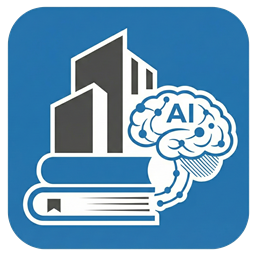
  </a>
</p>

<h1>ICST LAB</h1>

<p>
  <strong>Official Interactive Training &amp; Simulation Platform of <a href="https://icstconnect.in">ICST Connect (icstconnect.in)</a></strong><br/>
  <em>Institute of Computer Science and Technology — Chowberia, Nadia, West Bengal, India</em>
</p>

<p>
  <a href="https://icstconnect.in"></a>
  
  
  
  
  
  
</p>

<p>
  <a href="#-live-screenshots-gallery">Screenshots</a> •
  <a href="#-the-6-interactive-labs">6 Interactive Labs</a> •
  <a href="#-modern-cursor-studio-5-themes--41-cursors">Cursor Studio</a> •
  <a href="#-system-architecture">Architecture</a> •
  <a href="#-getting-started">Getting Started</a> •
  <a href="#-workspace-agent-skills">Agent Skills</a>
</p>

<br/>

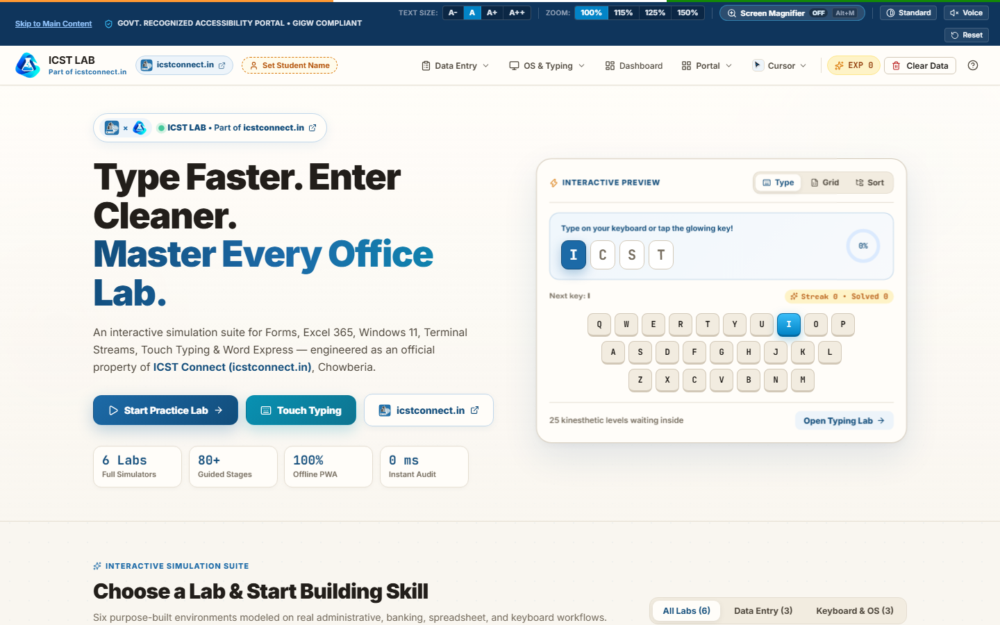

</div>

---

## 🏛️ Overview

**ICST LAB** is an institutional-grade, offline-first interactive training suite developed for the **Institute of Computer Science and Technology (ICST), Chowberia**, operating as an official digital learning property of **[ICST Connect (`https://icstconnect.in`)](https://icstconnect.in)**.

Engineered with an **Eye-Care Warm Tone** palette, **GIGW Government Accessibility Bar** (font scaling, page zoom, screen magnifier, speech reader, and High Contrast mode), **Anime.js v4** UI choreography, bilingual **English + সহজ বাংলা** guidance, and a **5-theme Modern Cursor Studio**, the platform trains students across **6 realistic simulators** spanning data entry, spreadsheets, operating system mastery, heads-down voucher dispatch, kinesthetic touch typing, and gamified rapid word delivery.

---

## 📸 Live Screenshots Gallery

### Command Center & Data Entry Suite

<table>
  <tr>
    <td width="50%" valign="top">
      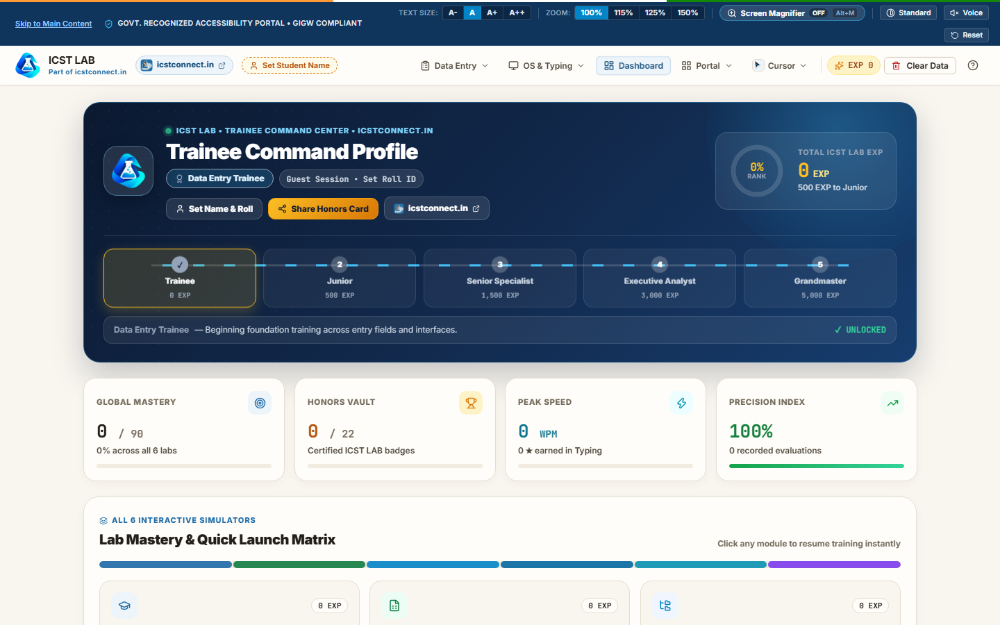
      <p align="center"><strong>Trainee Command Center (<code>#dashboard</code>)</strong><br/><sub>Orbital EXP ring, clickable 5-rank career ladder, 4 live KPI cards, 6-lab mastery matrix &amp; 22-badge Trophy Vault</sub></p>
    </td>
    <td width="50%" valign="top">
      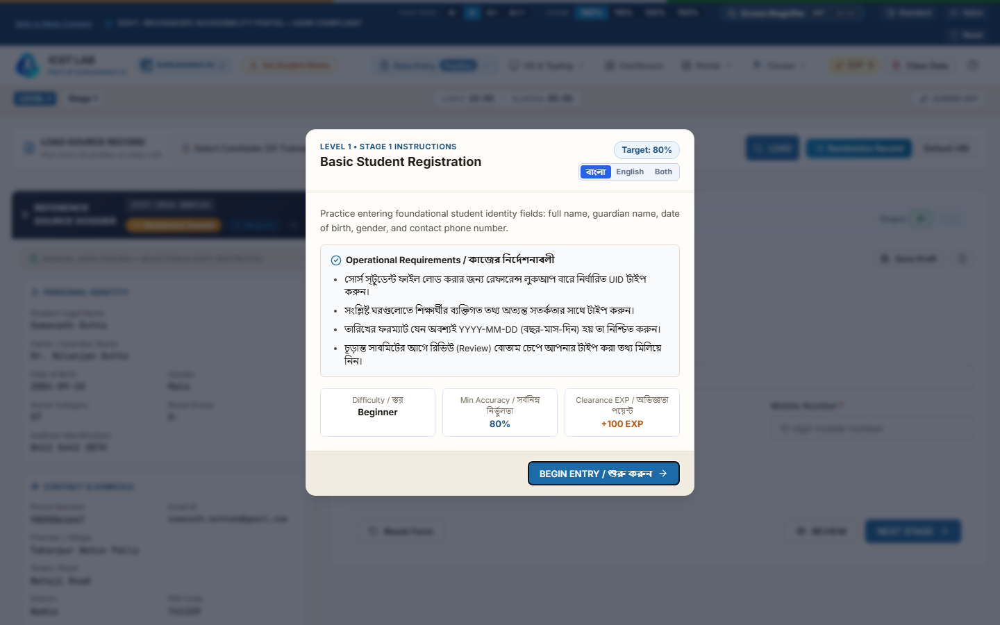
      <p align="center"><strong>Practice Lab (<code>#practice</code>)</strong><br/><sub>5 Levels &bull; 18 Stages covering UID lookup, Aadhaar formatting, WBBSE/WBCHSE marksheets &amp; bilingual English/বাংলা instructions</sub></p>
    </td>
  </tr>
  <tr>
    <td width="50%" valign="top">
      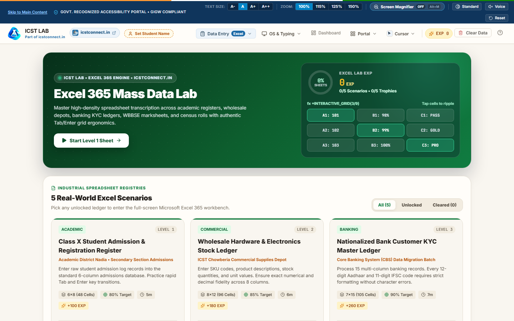
      <p align="center"><strong>Excel 365 Mass Data Lab (<code>#excel</code>)</strong><br/><sub>5 Industrial Spreadsheet Scenarios, interactive 3&times;3 cell ripple preview, Tab/Enter/F2 grid ergonomics &amp; 5 SVG Trophies</sub></p>
    </td>
    <td width="50%" valign="top">
      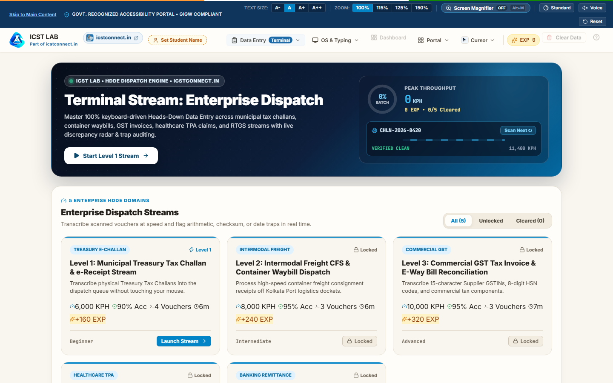
      <p align="center"><strong>Terminal Stream Lab (<code>#terminal</code>)</strong><br/><sub>100% keyboard-driven Heads-Down Data Entry (HDDE) across 5 enterprise domains with real-time trap radar up to 14,000 KPH</sub></p>
    </td>
  </tr>
</table>

### OS Organization, Typing Labs & Responsive Mobile Experience

<table>
  <tr>
    <td width="50%" valign="top">
      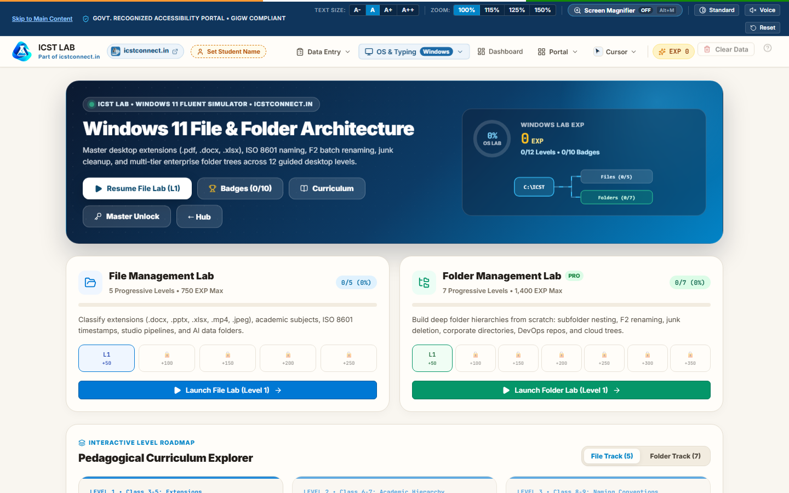
      <p align="center"><strong>Windows 11 Organization Lab (<code>#windows</code>)</strong><br/><sub>12 Progressive Desktop Levels across File Management (5) &amp; Folder Architecture (7) with F2 renaming &amp; ISO 8601 conventions</sub></p>
    </td>
    <td width="50%" valign="top">
      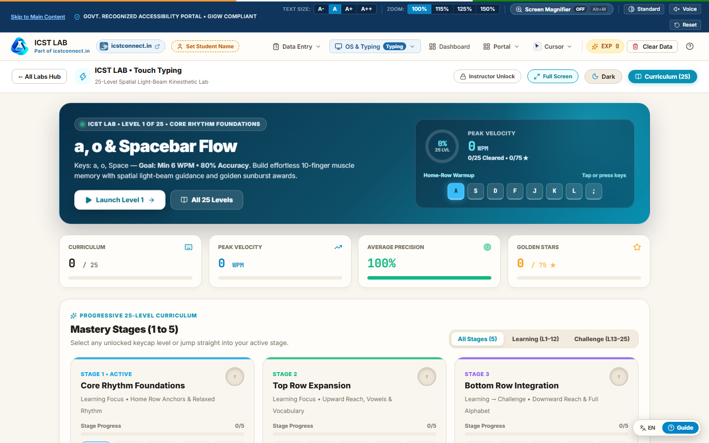
      <p align="center"><strong>Touch Typing Lab (<code>#typing</code>)</strong><br/><sub>25 Spatial Light-Beam Levels (50% Learning / 50% Challenge), Home-Row warmup, pre-start Hand Setup Guide &amp; mandatory Fullscreen</sub></p>
    </td>
  </tr>
  <tr>
    <td width="65%" valign="top">
      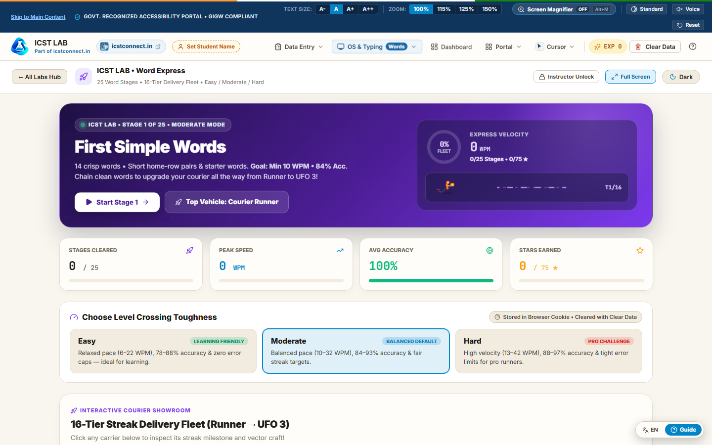
      <p align="center"><strong>Word Express Delivery Lab (<code>#word-express</code>)</strong><br/><sub>25 Word Stages, Cookie-backed Easy/Moderate/Hard toughness, 16-Tier Streak Courier Fleet (Runner &rarr; UFO 3), animated telemetry report &amp; English/সহজ বাংলা guide</sub></p>
    </td>
    <td width="35%" valign="top" align="center">
      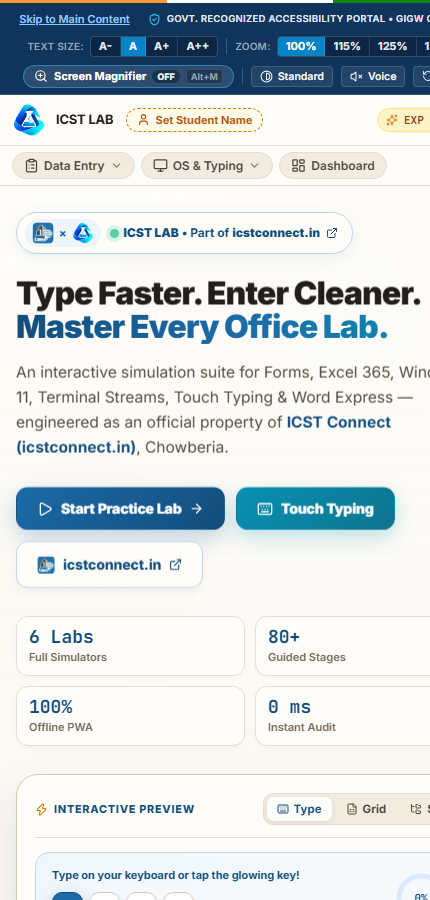
      <p align="center"><strong>Mobile &amp; Tablet Ready</strong><br/><sub>Slide-over drawer navigation + animated OTG/Bluetooth physical keyboard recommendation for mobile typing labs</sub></p>
    </td>
  </tr>
</table>

---

## 🎯 The 6 Interactive Labs

| Lab Module | Hash Route | Scope | Signature Capabilities |
| :--- | :---: | :---: | :--- |
| **📋 Practice Lab** | `#practice` | 5 Levels &bull; 18 Stages | Physical dossier lookup, separate prefix dropdown, unspaced 12-digit Aadhaar validation, WBBSE/WBCHSE marksheet tables, review audit |
| **📊 Excel 365 Mass Lab** | `#excel` | 5 Scenarios &bull; 5 Trophies | Authentic Excel emerald formula bar (`fx`), split-pane anti-copy physical ledger, `Tab`/`Enter`/`Arrow`/`F2` keyboard muscle memory, cell-by-cell audit |
| **⚡ Terminal Stream Lab** | `#terminal` | 5 Enterprise Domains | 100% mouse-free Heads-Down Data Entry (Municipal Tax Challans, Freight Waybills, GST Invoices, Healthcare TPA, Banking RTGS) + trap detection |
| **🪟 Windows 11 Org Lab** | `#windows` | 12 Levels (5 File + 7 Folder) | Fluent Mica desktop simulator, extension sorting (`.pdf`, `.docx`, `.xlsx`), `F2` batch renaming, deep folder trees &amp; 10 badges |
| **⌨️ Touch Typing Lab** | `#typing` | 25 Levels (75 Stars) | Light-beam finger cues, persistent practicing-keys strip, pre-start `HandSetupGuide`, balanced 50/50 learning/challenge curve, mandatory Fullscreen |
| **🚀 Word Express Lab** | `#word-express` | 25 Stages &bull; 16 Vehicles | Left-to-center-to-right animated delivery queue, streak persistence across stages, typo vibration + 1-tier downgrade, cookie-backed Easy/Moderate/Hard, animated post-stage telemetry &amp; bilingual English/সহজ বাংলা helper |

---

## 🖱️ Modern Cursor Studio (5 Themes × 41 Cursors)

ICST LAB ships with a bespoke **41-cursor brand-matched SVG suite** covering every CSS interaction state (**Standard & navigation**, **Selection & interaction**, **Drag & drop + custom `dragging`**, **14 Resize directions**, **Zoom**, and **6 Custom ICST Labs states**: `icst-default`, `icst-pointer`, `icst-click`, `icst-loading`, `icst-success`, `icst-error`).

Switch anytime from the **Cursor** dropdown in the navigation bar — complete with real-time **Auto Dark/Light surface luminance switching** (+ manual `Auto | Light | Dark` override) and `localStorage` persistence.

| Light Preview | Dark Preview | Theme | Type | Design Inspiration &amp; Motion |
| :---: | :---: | :--- | :---: | :--- |
|  |  | **ICST Fluent** *(Default)* | Static | Soft-cornered Win11-style delta arrow &amp; crisp floating pill badges |
|  |  | **Outlier Minimal** | Static | Clean hollow rounded geometric outline &amp; chevron resizers (`< >`, `^ v`) |
|  |  | **Stealth Rim** | Static | Aerodynamic carbon silhouette with glowing concave bevel &amp; precision needles |
|  |  | **Pulse Orbit** | **Animated** | 60fps GPU orbital satellite ring, hover morph &amp; Anime.js v4 sonar click-ripple *(Fullscreen-aware)* |
|  |  | **Prism Aurora** | **Animated** | Iridescent hollow prism, rotating chromatic aura, 5-node kinetic comet trail &amp; 6-spark click burst |

---

## 🏗️ System Architecture

```mermaid
flowchart TD
    Root["ICST LAB (icstconnect.in)"]

    Root --> DE["Data Entry Suite"]
    Root --> OT["OS & Typing Suite"]
    Root --> HUB["Command & Honors Hub"]
    Root --> CORE["Platform Core"]

    DE --> P["Practice Lab (#practice) · 18 Stages"]
    DE --> E["Excel 365 Lab (#excel) · 5 Ledgers"]
    DE --> T["Terminal Stream (#terminal) · 5 HDDE Streams"]

    OT --> W["Windows 11 Lab (#windows) · 12 Levels"]
    OT --> TT["Touch Typing (#typing) · 25 Levels"]
    OT --> WE["Word Express (#word-express) · 16-Vehicle Fleet"]

    HUB --> SD["Trainee Command Center (#dashboard)"]
    HUB --> TD["Teacher Portal (#teacher) · PIN Gated"]
    HUB --> SH["Live Showcase & Canvas Certificates (#showcase)"]

    CORE --> AN["Anime.js v4.5 Scoped UI Motion"]
    CORE --> CS["5-Theme Modern Cursor Studio + Auto Light/Dark"]
    CORE --> A11Y["GIGW Accessibility Bar & Eye-Care Warm Theme"]
    CORE --> PWA["Offline Service Worker (sw.js) + SEO Sitemap"]
```

---

## ✨ Platform Highlights

- **👁️ Eye-Care Warm Tone Palette**: Warm ivory (`#f9f6f0`), parchment (`#fffdf9`), and charcoal (`#1c1915`) tokens engineered to prevent retinal glare during multi-hour lab sessions.
- **♿ GIGW Accessibility Bar**: Live font-size presets (`A-` to `A++`), viewport zoom (`100%`–`150%`), interactive Screen Magnifier (`Alt+M`), Voice Speech Reader, and full yellow-on-black **High Contrast** mode across every view and modal.
- **🌐 Bilingual English + সহজ বাংলা Support**: Non-blocking Lab Guide Assistant in typing labs, bilingual Practice stage instructions, and animated mobile/tablet physical keyboard OTG/Bluetooth guidance.
- **🏆 Canvas 2D Certificate & Story Exporter**: High-DPI 9:16 Instagram/WhatsApp Story and 4:5 Feed achievement cards stamped with student identity, accuracy, speed, and official ICST credentials.
- **⚡ Offline-First PWA**: Service Worker (`public/sw.js`, cache `icst-lab-v8`) with instant hashed-asset caching, unobtrusive offline pill, Web App Manifest, and full `localStorage` + cookie retention until explicit **Clear Data**.
- **🔍 Full SEO & Structured Data**: Synchronized `index.html` JSON-LD `@graph`, `public/sitemap.xml`, `public/robots.txt`, and runtime per-view metadata syncing (`src/utils/dynamicTitle.ts`).

---

## 🛠️ Technology Stack

| Layer | Technology |
| :--- | :--- |
| **UI Framework** | React 19 + TypeScript 6 (`strict` via `tsc -b`) |
| **Bundler** | Vite 8 (`vite.config.ts`) |
| **UI Motion** | Anime.js v4.5 (`animate`, `createScope`, `stagger`, `spring`) |
| **Iconography** | Lucide React + Custom SVG Cursor & Trophy Libraries |
| **Certificates & FX** | HTML5 Canvas 2D API + `canvas-confetti` |
| **Offline & Storage** | Service Worker (`public/sw.js`) + `manifest.json` + `localStorage` & Cookies |

---

## 📁 Project Structure

```text
data-entry-training-system/
├── .agent/                      # Exported Antigravity workspace skills (6 skills + scripts)
├── docs/screenshots/            # Live rendered screenshots embedded in this README
├── public/
│   ├── cursors/<theme>/<tone>/  # 5 themes × 2 tones × 41 modern 32×32 SVG cursors
│   ├── logo.png                 # Official ICST LAB flask-ribbon emblem (512×512)
│   ├── icstconnect-logo.png     # Official ICST Connect logo (icstconnect.in)
│   ├── favicon.png              # 64×64 & 32×32 PNG favicons + PWA icons
│   ├── manifest.json            # Offline PWA Web App Manifest
│   ├── sitemap.xml & robots.txt # Search engine sitemap & crawler directives
│   └── sw.js                    # Offline Service Worker (icst-lab-v8)
├── src/
│   ├── components/
│   │   ├── common/              # Header, Footer, GIGW Bar, Cursor Overlay, Keyboard Notice, Modals
│   │   ├── landing/             # Animated Landing Page & interactive 3-mode hero preview
│   │   ├── practice/            # Single-form & WBBSE/WBCHSE Marksheets Workbench
│   │   ├── excel/               # Excel 365 Dashboard, Workbench & Evaluation Modal
│   │   ├── windows/             # Windows 11 File & Folder Organization Lab
│   │   ├── terminal/            # Terminal Stream HDDE Dispatch Lab
│   │   ├── typing/              # 25-Level Touch Typing Lab & Hand Setup Guide
│   │   ├── wordExpress/         # 25-Stage Word Express Delivery Lab, 16-Tier Fleet & Report
│   │   ├── student/             # Trainee Command Center Dashboard
│   │   ├── showcase/            # Promotional Honors Showcase
│   │   └── teacher/             # Passcode-gated Instructor Portal
│   ├── config/appConfig.ts      # Centralized ICST LAB & ICST Connect portal configuration
│   ├── styles/icstCursors.css   # 41 cursor tokens, semantic bindings, animated overlay & studio UI
│   ├── utils/icstCursor.ts      # 5-theme cursor registry & Auto Dark/Light luminance detector
│   └── utils/dynamicTitle.ts    # Runtime per-view SEO metadata updater
├── AGENTS.md                    # Workspace engineering, branding & SEO rules
├── MEMORY.md                    # Living architecture & change-log memory
└── README.md                    # Project showcase & documentation
```

---

## 💻 Getting Started

### Prerequisites
- [Node.js](https://nodejs.org/) v18+ and `npm`

### 1. Clone & Install
```bash
git clone https://github.com/icstconnect/data-entry-training-system.git
cd data-entry-training-system
npm install
```

### 2. Start Development Server
```bash
npm run dev
```
Open `http://localhost:5173/` in your browser.

### 3. Production Build & Preview
```bash
npm run build
npm run preview
```

---

## 🔑 Instructor / Teacher Mode Access

1. Open **Portal ▾ &rarr; Teacher Mode** from the top navigation bar.
2. Enter the institutional instructor passcode (`icst2026`) to inspect class audits, unlock scenarios, and manage student progress.

---

## 🤖 Workspace Agent Skills

Reusable AI agent workflows for this repository are exported in [`.agent/`](./.agent/README.md):
- `icst-lab-branding-seo-pwa` — Branding, dual logos, favicons/PWA icons, SEO/sitemap & Service Worker hygiene
- `icst-animejs-v4-ui-motion` — Anime.js v4.5 React 19 scoped motion & strict TypeScript patterns
- `icst-typing-labs-architecture` — Touch Typing & Word Express mechanics, fullscreen & bilingual UX
- `icst-modern-cursor-studio` — 5-theme × 41-cursor SVG generator, Auto Dark/Light switching & animated overlays
- `icst-module-dashboard-design` — Eye-Care Warm Tone, grouped navbar, module dashboards & GIGW contrast
- `icst-windows-powershell-build-ops` — Windows PowerShell 5.1 ops, XML/image validation & build gate

---

<div align="center">

**Institute of Computer Science and Technology (ICST) — Chowberia**  
Chowberia, Nadia District, West Bengal, India • Official Property of **[ICST Connect (`https://icstconnect.in`)](https://icstconnect.in)**  
<sub>Institutional Proprietary &bull; All Rights Reserved</sub>

</div>
